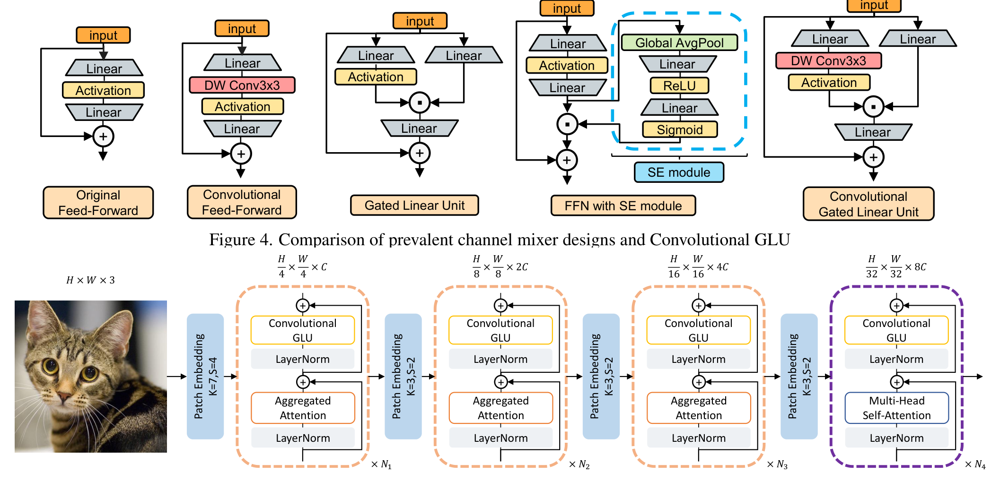

## 一、论文出处

- 论文全名：TransNeXt: Robust Foveal Visual Perception for Vision Transformers
- 会议/年份：CVPR 2024
- 论文链接：https://arxiv.org/abs/2311.17132
- 官方代码：https://github.com/DaiShiResearch/TransNeXt

## 二、模块图（截自论文原文）



图注：左侧是聚合注意力（Aggregated Attention）的两条并行分支——卷积式中心凹注意力负责局部高分辨率感知，像素级周边注意力负责全局低分辨率感知；右侧是 Convolutional GLU，用最近邻卷积特征做门控。两者组合成 TransNeXt 的骨干 block。

## 三、核心思想与作用

一句话总括：聚合注意力把「人眼中心凹 + 眼球扫视」这件事翻译成 token mixer，让每个 token 在一次前向里同时拿到局部细节和全局上下文，而且复杂度是线性的。

拆解成几步看：

1. **中心凹分支（卷积式）**：把特征图按窗口做卷积式的局部聚合，模拟视网膜中央凹的高分辨率采样。它负责「看得清」，对纹理、边界这类高频信息敏感。
2. **周边分支（像素级）**：对整张特征图做低分辨率的全局池化式聚合，模拟余光对整幅场景的粗感知。它负责「看得全」，提供长程依赖。
3. **两路融合**：两个分支的输出按位置相加/拼接后过投影，得到每个 token 的全局感知表示。因为周边分支是在降采样后的像素级上做的，整体复杂度随分辨率线性增长，而不是标准注意力的平方。
4. **可学习 token 参与 Q/K**：除了 query 和 key 的相似度，还引入一组可学习 token 与它们交互，让亲和矩阵的来源更多样，不完全依赖 query-key 点积。

为什么好：

- **形变鲁棒性**：中心凹分支的卷积式局部聚合对几何形变不敏感，周边分支又补上全局，比纯窗口注意力更抗形变。
- **线性复杂度**：全局建模不靠堆层数换感受野，避免了残差连接带来的深度退化（depth degradation），浅层就能形成足够的信息混合。
- **即插即用**：它本质是一个 token mixer，输入输出形状一致，可以替换掉 U-Net 里任意一个标准注意力或卷积 block。

## 四、在 U-Net 里的插入位置

这个模块最适合放在**编码器的中后段**和**瓶颈层（bottleneck）**。

理由：

- 编码器浅层特征图分辨率高，中心凹分支的卷积开销还能接受，但周边分支的全局聚合在浅层收益不大，反而增加计算。放到中后段，特征图已经降采样过，全局分支的性价比最高。
- 瓶颈层是 U-Net 里感受野需求最大的位置，聚合注意力的全局感知正好补上标准卷积感受野不足的问题，同时线性复杂度不会让瓶颈层爆炸。
- 解码器里如果要用，建议放在跳跃连接融合之后、上采样之前，用来在恢复分辨率前先做一次全局信息重整。不建议放在最浅的解码层，那里更依赖局部细节。

## 五、复现代码（PyTorch，逐行中文注释）

> 说明：以下是**简化教学版**，只保留聚合注意力最核心的两个组件——卷积式中心凹分支和像素级周边分支，以及它们的融合。省略了论文里的可学习 token、多头分组、位置编码等工程细节，目的是让你看清结构。

```python
import torch
import torch.nn as nn
import torch.nn.functional as F


class SimplifiedAggregatedAttention(nn.Module):
    """
    简化版聚合注意力：两路设计
    - 中心凹分支：深度可分离卷积，局部高分辨率聚合
    - 周边分支：全局平均池化 + 线性投影，低分辨率全局聚合
    两路输出相加后过投影，输出形状与输入一致，可直接替换标准注意力。
    """

    def __init__(self, dim, foveal_kernel=3):
        super().__init__()
        self.dim = dim

        # ---- 中心凹分支：深度可分离卷积，模拟局部高分辨率感知 ----
        # 用 depthwise 卷积控制参数量，padding 保持空间尺寸不变
        self.foveal_conv = nn.Conv2d(
            dim, dim,
            kernel_size=foveal_kernel,
            padding=foveal_kernel // 2,
            groups=dim,          # depthwise，每个通道独立卷积
            bias=False
        )
        self.foveal_bn = nn.BatchNorm2d(dim)

        # ---- 周边分支：全局平均池化到 1x1，再线性映射回 dim ----
        # 这一步把整张图压成一个全局描述子，复杂度与分辨率线性相关
        self.peripheral_fc = nn.Linear(dim, dim)

        # ---- 融合后的输出投影 ----
        self.out_proj = nn.Conv2d(dim, dim, kernel_size=1, bias=False)
        self.out_bn = nn.BatchNorm2d(dim)

    def forward(self, x):
        # x: (B, C, H, W)
        B, C, H, W = x.shape

        # 中心凹分支：局部卷积 + BN + 激活
        foveal = self.foveal_conv(x)          # (B, C, H, W)
        foveal = self.foveal_bn(foveal)
        foveal = F.gelu(foveal)

        # 周边分支：全局池化 -> 线性 -> 广播回原尺寸
        peripheral = F.adaptive_avg_pool2d(x, 1)   # (B, C, 1, 1)
        peripheral = peripheral.flatten(1)          # (B, C)
        peripheral = self.peripheral_fc(peripheral) # (B, C)
        peripheral = peripheral[:, :, None, None]   # (B, C, 1, 1)
        peripheral = peripheral.expand(-1, -1, H, W)  # 广播到 (B, C, H, W)

        # 两路融合：逐元素相加，让每个位置同时拥有局部和全局信息
        out = foveal + peripheral

        # 输出投影 + BN，保持与输入同分布
        out = self.out_proj(out)
        out = self.out_bn(out)

        # 残差连接，方便直接塞进现有网络
        return x + out
```

## 六、插入示例（几行塞进你的网络）

```python
# 假设你在写一个 U-Net 的编码器 block
class EncoderBlock(nn.Module):
    def __init__(self, in_ch, out_ch):
        super().__init__()
        self.conv = nn.Sequential(
            nn.Conv2d(in_ch, out_ch, 3, padding=1),
            nn.BatchNorm2d(out_ch),
            nn.ReLU(inplace=True)
        )
        # 把简化版聚合注意力插在卷积之后
        self.agg_attn = SimplifiedAggregatedAttention(out_ch)

    def forward(self, x):
        x = self.conv(x)
        x = self.agg_attn(x)   # 即插即用，形状不变
        return x
```

## 七、实测经验与注意点

- **复杂度**：周边分支的全局池化是 O(HW)，中心凹分支的 depthwise 卷积也是 O(HW·k²)，整体对分辨率线性。但如果你把 foveal_kernel 开大（比如 7），浅层高分辨率下显存会明显上涨，建议浅层用 3、深层用 5 或 7。
- **超参**：dim 要和输入通道对齐；如果输入通道数不匹配，先在外部加一个 1x1 卷积做通道映射，再进模块。
- **踩坑**：简化版里周边分支用的是全局平均池化，对医学图像里的小病灶可能过度平滑。实际用时可以改成自适应最大池化，或者保留多尺度池化（1x1、2x2、4x4）再拼接。
- **BN 与 batch size**：模块里用了 BN，小 batch 训练时统计量不稳，建议换成 GroupNorm 或 LayerNorm，尤其是 3D 医学数据。
- **位置**：不要在每个编码层都堆这个模块，中后段 + 瓶颈层各放一个就够，浅层放了收益低还拖速度。
- **和标准注意力的区别**：它没有 query-key 点积，所以不需要位置编码来补位置信息，卷积本身带了局部位置先验，这一点在形变大的医学数据上是优势。

## 八、完整工程

完整可运行代码和更多即插即用模块整理在：https://github.com/CaiCy6/med-modules

下一篇预告：拆解 CoReFuse 里的模态融合块，看它怎么在特征层做跨模态对齐后再插回 U-Net。
