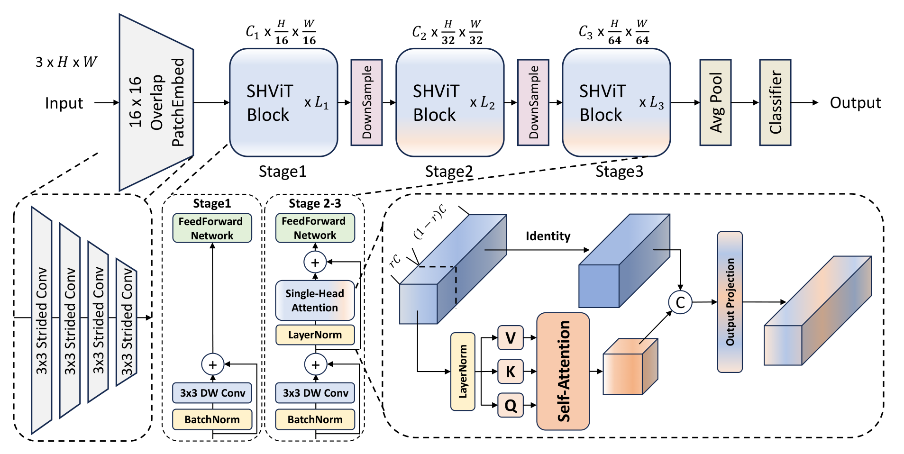

## 一、论文出处

- 论文全名：SHViT: Single-Head Vision Transformer with Memory Efficient Macro Design
- 会议/年份：CVPR 2024
- 论文链接：https://arxiv.org/abs/2401.16456
- 官方代码：https://github.com/ysj9909/SHViT

## 二、模块图（截自论文原文）



图里最值得盯的是两处：macro 层面用 stride 更大的 patchify stem 直接把特征图压小，micro 层面把标准多头注意力换成单头、并把全局分支和局部分支并行拼在一起。本文只讲后面这个可插拔的注意力子模块，也就是 SHViT 的单头注意力块（Single-Head Attention, SHA）。

## 三、核心思想与作用

一句话总括：**在轻量模型里，多头注意力的大部分头是冗余的，用一个头同时算全局和局部信息，比堆多个头更划算。**

拆解成几步看：

1. **先承认冗余**。标准 MHSA 把通道切成若干头，每个头独立做 QK^T 和加权求和。作者的分析指出，在后段 stage 里，多个头的输出高度相似，等于用几倍的算力换几乎一样的信息。头数越多，这种重复越明显。
2. **单头替代多头**。SHA 只保留一个注意力头，直接消掉“头冗余”这个来源，而不是靠剪枝事后补救。
3. **一个头里塞两种信息**。既然只有一个头，就让它同时承担全局和局部：全局分支做常规的全局注意力（带空间下采样以省算力），局部分支用深度可分离卷积在局部窗口上建模，两路并行后拼接/相加。
4. **配合 macro 设计**。更大的 stride patchify 让 token 数从一开始就少，注意力矩阵小，单头才跑得动。

为什么好：注意力矩阵的规模随头数线性增长，单头直接把这块显存和访存砍掉；并行全局+局部让单头不至于丢掉局部细节，精度反而比纯全局注意力更稳。对移动端来说，瓶颈往往不是 FLOPs 而是内存访问，单头 + 下采样正好压住访存。

## 四、在 U-Net 里的插入位置

推荐放在**编码器后段（stage3/stage4）和瓶颈层**，不建议放最前面的高分辨率层。

理由：

- 浅层特征图分辨率高、token 多，注意力矩阵是平方级开销，放这里性价比低；论文本身也建议早期 stage 用卷积替代注意力。
- 后段和瓶颈层 token 数已经降下来，全局建模的收益最大，而这里恰好是 MHSA 头冗余最严重的地方，换成 SHA 收益最直接。
- 解码器如果要做跨层全局融合，也可以在 skip 汇合处插一个 SHA，但要注意上采样后的分辨率，必要时先下采样再做注意力。

一句话：**高分辨率用卷积，低分辨率用 SHA。**

## 五、复现代码（PyTorch，逐行中文注释）

> 说明：这是**简化教学版**，只保留 SHA 最核心的两个组件——单头全局注意力 + 并行局部分支，去掉了原论文里的训练技巧、位置编码细节和工程优化，方便你直接读懂结构并塞进自己的网络。

```python
import torch
import torch.nn as nn


class SingleHeadAttention(nn.Module):
    """SHViT 的单头注意力块（简化教学版）。

    核心：只用一个注意力头做全局建模，同时并行一个深度可分离卷积分支做局部建模，
    两路结果相加后过一层投影。这样既避免了多头冗余，又不丢局部细节。
    """

    def __init__(self, dim, num_heads=1, sr_ratio=2, kernel_size=3):
        super().__init__()
        assert num_heads == 1, "本模块只保留单头，头数固定为 1"
        self.dim = dim
        self.sr_ratio = sr_ratio  # 全局分支的空间下采样比例，用来压注意力矩阵

        # ---- 全局分支：单头 QKV ----
        # 一个头，所以 qkv 的通道数就是 dim，不再做多头切分
        self.q = nn.Conv2d(dim, dim, kernel_size=1)
        self.kv = nn.Conv2d(dim, dim * 2, kernel_size=1)

        # 对 K/V 做空间下采样，减少注意力矩阵规模（内存高效的关键）
        self.sr = nn.Conv2d(dim, dim, kernel_size=sr_ratio, stride=sr_ratio) if sr_ratio > 1 else nn.Identity()
        self.norm = nn.GroupNorm(1, dim)  # 用 GN 做归一化，batch 小时比 BN 稳

        # ---- 局部分支：深度可分离卷积，建模局部窗口 ----
        self.local = nn.Sequential(
            nn.Conv2d(dim, dim, kernel_size=kernel_size, padding=kernel_size // 2,
                      groups=dim, bias=False),   # 深度卷积，逐通道做局部聚合
            nn.GroupNorm(1, dim),
            nn.GELU(),
            nn.Conv2d(dim, dim, kernel_size=1, bias=False),  # 逐点卷积，做通道混合
        )

        # ---- 输出投影 ----
        self.proj = nn.Conv2d(dim, dim, kernel_size=1)

    def forward(self, x):
        # x: [B, C, H, W]
        B, C, H, W = x.shape

        # ===== 全局分支 =====
        q = self.q(x)                      # [B, C, H, W]
        kv = self.kv(x)                    # [B, 2C, H, W]
        k, v = kv.chunk(2, dim=1)          # 各 [B, C, H, W]

        if self.sr_ratio > 1:
            k = self.sr(k)                 # 下采样 K
            v = self.sr(v)                 # 下采样 V，注意力矩阵随之变小
        k = self.norm(k)
        v = self.norm(v)

        # 展平成序列，单头注意力：softmax(Q K^T / sqrt(d)) V
        Bk, Ck, Hk, Wk = k.shape
        q_flat = q.flatten(2).transpose(1, 2)          # [B, HW, C]
        k_flat = k.flatten(2).transpose(1, 2)          # [B, HkWk, C]
        v_flat = v.flatten(2).transpose(1, 2)          # [B, HkWk, C]

        scale = C ** -0.5
        attn = torch.softmax(q_flat @ k_flat.transpose(1, 2) * scale, dim=-1)  # [B, HW, HkWk]
        global_out = attn @ v_flat                     # [B, HW, C]
        global_out = global_out.transpose(1, 2).reshape(B, C, H, W)

        # ===== 局部分支 =====
        local_out = self.local(x)          # [B, C, H, W]

        # 两路并行相加，再投影输出
        out = self.proj(global_out + local_out)
        return out
```

## 六、插入示例（几行塞进你的网络）

```python
import torch
import torch.nn as nn
from torch import Tensor

# 假设你有一个 U-Net 的瓶颈层特征 x: [B, 256, 16, 16]
sha = SingleHeadAttention(dim=256, num_heads=1, sr_ratio=2, kernel_size=3)

x: Tensor = torch.randn(2, 256, 16, 16)
y = sha(x)          # 输出形状不变: [2, 256, 16, 16]
print(y.shape)
```

把它当成一个 shape 不变的 block，直接替换瓶颈层或编码器后段的 MHSA 即可，前后接卷积/上采样都不用改。

## 七、实测经验与注意点

- **头数固定为 1**：这是模块的定义，不要为了“看起来更强”改回多头，那等于退回原问题。想加容量就加通道或加层。
- **sr_ratio 是主要超参**：下采样太狠（比如 4 以上）会丢全局细节，太小又省不下显存。后段特征图小的时候用 1~2，瓶颈层可以到 2~4，按分辨率调。
- **别放浅层**：高分辨率下注意力矩阵是平方开销，SHA 也救不了。浅层老老实实用卷积或深度可分离卷积。
- **归一化选择**：医学图像 batch 往往很小，BN 统计不稳，代码里用 GroupNorm(1, C) 更保险；如果你 batch 够大，换回 LayerNorm/BN 也行。
- **复杂度**：全局分支的注意力是 O(HW · HkWk)，下采样后 HkWk 大幅缩小；局部分支是 O(HW · k²)，整体比同通道 MHSA 轻，显存占用下降更明显。
- **踩坑**：`sr_ratio` 要能整除特征图尺寸，否则卷积下采样会丢边；上采样回原尺寸时注意用 `reshape` 而不是 `view`，避免非连续内存报错。

## 八、完整工程

以上代码已整理进统一仓库，可直接 clone 跑通：https://github.com/CaiCy6/med-modules

下一篇预告：拆解另一个即插即用的模态融合块，讲清楚它怎么在多模态医学分割里单独塞进 U-Net 的 skip 连接。
